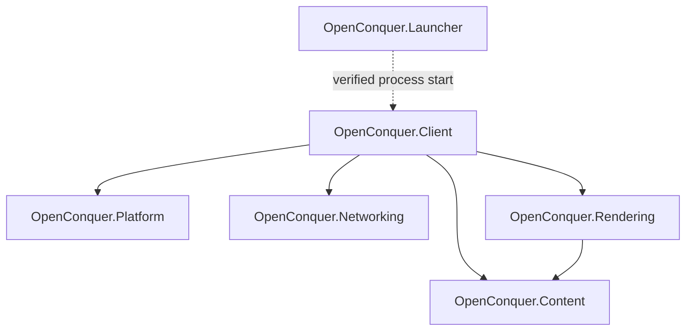

# OpenConquer Client

[](https://github.com/berniemackie97/OpenConquerClient/actions/workflows/ci.yml)

OpenConquer Client is a C#/.NET 10 modernization of the Conquer Online 5517 client ecosystem for
Windows, macOS, and Linux.

**Development preview.** Local authenticated play is available for supported flows. Public release and general gameplay are in development.


## OpenConquerStudio

OpenConquerStudio has its own content-authoring repository and solution.
This client solution contains the game, launcher and required runtime/tooling libraries.
Image decoders live in `OpenConquer.Content/Images`; world drawing lives in
`OpenConquer.Rendering/World`. These are folders in the existing Content and Rendering projects.
Studio keeps a recorded source snapshot of those two projects;
its desktop application, authoring model, resource codecs and tools have separate ownership.
See [Studio integration](docs/studio-integration.md) for the extraction boundary.

## Local game content

`content/` is ignored and is not supplied by a source checkout. Existing local files are preserved.
Restore your verified content set under `content/retail-5517/` to run the client with game assets.
An asset-free checkout still builds and runs the unit tests. CI reports the asset-dependent map,
release-package and managed-installation gates as unrun until private asset provisioning is configured.
See [local content](docs/content/local-content.md). Removing tracked files does not erase prior Git history.

## Current capabilities

| Area | Implemented | Open work |
| --- | --- | --- |
| Launcher | Retail play screen, managed installation and integrity checks, single-instance activation, display settings and verified local client start. Signed package acquisition and update, repair and rollback primitives. | Production release origin, player-facing maintenance workflow and launcher self-update. |
| Login | Publisher-signed realm selection, retail login and error presentation, AccountServer authentication, OpenConquer registration, GameServer handshake and existing/new character admission. | Credential exchanges are limited to the signed local IPv4 loopback flow. Remote authentication needs authenticated transport. |
| World | Authenticated map activation, terrain and local role presentation, equipment appearance, hero attributes and vitals, ordinary walk echoes, position correction and heartbeat. | Input-driven movement, remote role presentation, broader packet coverage, combat, inventory interactions and world audio. |
| HUD | Retail layout and drawing, live supported hero vitals/experience, action and check controls, quickbar, selected-skill display and category-8/9 status hints. | Gameplay effects of most controls, full live quickbar and skill state, remaining hints and tooltips. |

The [Client Roadmap](https://github.com/users/berniemackie97/projects/4) tracks work and acceptance.
The [architecture overview](docs/architecture/architecture.md) describes ownership and links the
supported login and world flows.

## Architecture



The dashed edge is a process handoff. The launcher and game have separate builds and publish outputs.
Game state, presentation coordination and session lifetime belong to Client. Platform owns the
desktop host and input, Rendering owns graphics, Content owns asset access and formats, and
Networking owns codecs and transport.

## Build

Use the SDK pinned by [`global.json`](global.json).

```bash
dotnet restore OpenConquer.Client.slnx --locked-mode
dotnet format OpenConquer.Client.slnx --verify-no-changes --no-restore
dotnet build OpenConquer.Client.slnx -c Release --no-restore
dotnet test OpenConquer.Client.slnx -c Release --no-build --no-restore
```

CI builds and tests on Linux, Windows, and macOS. See [`CONTRIBUTING.md`](CONTRIBUTING.md) for the
full set of checks to run before opening a pull request.

Linux CI also runs a synthetic OpenGL framebuffer check. Full retail conformance uses authorized
assets and a supported desktop OpenGL driver. See the [verification guide](docs/development.md#rendering-conformance).

## Run

With a verified local content set, create or refresh the managed development product:

```bash
dotnet run \
  --project tools/OpenConquer.Product.Tool \
  --configuration Release \
  -- \
  create-local-product
```

The product is written to:

```text
artifacts/local-product/product
```

Start the launcher on macOS or Linux:

```bash
./artifacts/local-product/product/OpenConquer.Launcher
```

On Windows:

```powershell
.\artifacts\local-product\product\OpenConquer.Launcher.exe
```

During development you can also run the client directly:

```bash
dotnet run --project src/OpenConquer.Client -- \
  --content-root content/retail-5517/payload \
  --window-size 1280x720 \
  --window-mode resizable \
  --presentation fit
```

Client options:

| Option | Values |
| --- | --- |
| `--window-size` | `WIDTHxHEIGHT`; default `1280x720` |
| `--window-mode` | `resizable`, `fixed`, `fullscreen` |
| `--presentation` | `fit`, `integer`, `stretch` |
| `--content-root` | An authorized retail-compatible content tree |

The logical render size is either 800x600 or 1024x768, as selected by `ini/GameSetUp.ini`. Desktop
size, window mode, and presentation are set independently of each other and of the logical size.

## Compatibility

Retail 5517 is the reference for verified wire behavior, content semantics and player-visible
behavior. The client uses managed ownership, bounded asynchronous transport and OpenGL to
implement those contracts on current desktop platforms. The [evidence index](docs/compatibility/evidence-index.md)
distinguishes retail findings, managed choices and open proof gaps.

The runtime uses the local content closure defined by the importer and verified manifest.
WDF archives are import sources. Retail `Server.dat` is an offline compatibility reference.
Live endpoints come from the publisher-signed realm directory.

For HUD, sprite, text and draw-order details see [graphics](docs/compatibility/native-graphics.md)
and [text](docs/compatibility/native-text.md). World entry and frame ownership are covered in
[session ownership](docs/architecture/client-session-ownership.md) and
[world activation](docs/world/WORLD-014-world-scene-activation.md).

## Repository

```text
src/
├── OpenConquer.Client/
├── OpenConquer.Content/
├── OpenConquer.Launcher/
├── OpenConquer.Networking/
├── OpenConquer.Platform/
└── OpenConquer.Rendering/

tests/
├── Conformance/
│   └── OpenConquer.Rendering.Conformance/
├── OpenConquer.Client.Tests/
├── OpenConquer.Content.Tests/
├── OpenConquer.Content.Tool.Tests/
├── OpenConquer.Launcher.Tests/
├── OpenConquer.Platform.Tests/
├── OpenConquer.Product.Tool.Tests/
└── OpenConquer.Rendering.Tests/

content/
docs/

tools/
├── OpenConquer.Content.Tool/
└── OpenConquer.Product.Tool/
```

## Documentation

| Area | Document |
| --- | --- |
| Development | [`docs/development.md`](docs/development.md) |
| Architecture | [`docs/architecture/architecture.md`](docs/architecture/architecture.md) |
| Managed installation | [`docs/architecture/launcher-managed-installation.md`](docs/architecture/launcher-managed-installation.md) |
| Graphics compatibility | [`docs/compatibility/native-graphics.md`](docs/compatibility/native-graphics.md) |
| Text compatibility | [`docs/compatibility/native-text.md`](docs/compatibility/native-text.md) |
| Retail content | [`docs/content/retail-5517-content-plan.md`](docs/content/retail-5517-content-plan.md) |
| Retail inventory | [`docs/content/retail-5517-inventory.md`](docs/content/retail-5517-inventory.md) |
| Startup and login screen notes | [`docs/startup/`](docs/startup/README.md) |
| Login networking notes | [`docs/networking/`](docs/networking/README.md) |
