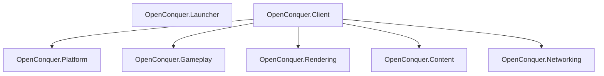

# OpenConquer Client

[](https://github.com/berniemackie97/OpenConquerClient/actions/workflows/ci.yml)

OpenConquer Client is a C#/.NET 10 reconstruction of the Conquer Online 5517 client ecosystem for
Windows, macOS, and Linux.

**Status:** early development. The launcher is not ready for release.


## Current Capabilities

| Product | Implemented | Remaining |
| --- | --- | --- |
| Launcher | Managed installation resolution, authenticated releases, integrity verification, update/repair/rollback transaction, single-instance activation, saved display preferences | Production release origin, launcher self-update, player-facing maintenance flow, controlled client startup |
| Client | Desktop host, logical rendering/presentation, verified retail content, TGA/DXT3 sprites, retail text rendering, static main-HUD chrome, life/mana/stamina vitals, skill/experience HUD, retail 10-button action strip, four retail main-HUD CMyCheck controls, 10-slot quickbar/grid, selected-skill image/cover, selected-skill cooldown text, main-HUD category-8 status hints and category-9 Magic hints | Live gameplay state, downstream HUD-control side effects, per-control tooltips, other status-hint categories, outer HUD gate, remaining UI, networking, maps, roles, effects, animation |

## Architecture



The launcher and the game client are separate products. Each one handles its own part of the flow:

```text
launcher
→ installation readiness
→ update / repair
→ pre-launch settings
→ controlled client startup

client
→ realm selection
→ AccountServer login
→ GameServer handoff
→ game
```

## Build

Use the SDK pinned by [`global.json`](global.json).

```bash
dotnet restore OpenConquer.Client.slnx --locked-mode
dotnet format OpenConquer.Client.slnx --verify-no-changes --no-restore
dotnet build OpenConquer.Client.slnx -c Release --no-restore
dotnet test OpenConquer.Client.slnx -c Release --no-build --no-restore
```

CI builds and tests on Linux, Windows, and macOS. See [`CONTRIBUTING.md`](CONTRIBUTING.md) for the
full set of checks to run before opening a pull request.

Rendering conformance tests run separately, with real GPU drivers on supported desktop hardware,
against the retail 5517 content.

## Run

Create or refresh the local managed product:

```bash
dotnet run \
  --project tools/OpenConquer.Product.Tool \
  --configuration Release \
  -- \
  create-local-product
```

The product is written to:

```text
artifacts/local-product/product
```

Start the launcher on macOS or Linux:

```bash
./artifacts/local-product/product/OpenConquer.Launcher
```

On Windows:

```powershell
.\artifacts\local-product\product\OpenConquer.Launcher.exe
```

During development you can also run the client directly:

```bash
dotnet run --project src/OpenConquer.Client -- \
  --window-size 1280x720 \
  --window-mode resizable \
  --presentation fit
```

Client options:

| Option | Values |
| --- | --- |
| `--window-size` | `WIDTHxHEIGHT`; default `1280x720` |
| `--window-mode` | `resizable`, `fixed`, `fullscreen` |
| `--presentation` | `fit`, `integer`, `stretch` |
| `--content-root` | An authorized retail-compatible content tree |

The logical render size is either 800x600 or 1024x768, as selected by `ini/GameSetUp.ini`. Desktop
size, window mode, and presentation are set independently of each other and of the logical size.

## Compatibility

The observable behavior of the retail 5517 client is the reference for compatibility. Once confirmed
against the original client, the following are preserved:

```text
protocol packets
credential transformations
cryptography
login results
game handoff semantics

logical rendering
content paths and lookup behavior
sprite behavior
HUD geometry and ordering
native UI state and input behavior
```

The original client's internal machinery is not copied when the same observable behavior can be
reproduced safely in another way.

### Runtime Content

The managed runtime closure currently contains 3,785 files totaling 21,319,841 bytes.

The full set of paths is defined by:

```text
content/retail-5517/manifest.json
content/retail-5517/payload
```

It currently covers:

```text
startup configuration
startup logos
ini/Font.ini
Control.ani

Progress45 HUD background
Dialog4 HUD panels

Progress40 life frames
Progress41 mana frames
Progress42 skill frames
Progress46 stamina frames
Progress47 extended-stamina frames

10-button main-HUD action strip
four native main-HUD CMyCheck controls

10-slot main-HUD quickbar/grid
fixed quickbar control artwork
action and dance families
magic and XP-magic families
item-min-icon families
verified glow families

Magic0 selected-skill image
Image0 selected-skill cover
selected-skill cooldown text configuration

category-8 main-HUD status hints
category-9 learned-magic and zero-magic hints
retail magic metadata, descriptions, subprofession requirements, and keyed localization
```

These four sets must always match:

```text
ClientContentClosure
        ==
tracked manifest
        ==
tracked payload
        ==
published client content
```

The closure is large on purpose. GFX-UI-006 added parameterized quickbar consumers, and their ANI
catalogs reference whole action, magic, item-icon, and glow families. The manifest is the source of
truth for the file list, so the list is not maintained by hand in Markdown.

Retail WDF archives are used only as import sources. They are not shipped in the curated content
set.

Retail `Server.dat` is kept as an offline compatibility reference. It is not runtime content.

### HUD

The main HUD is currently built from:

```text
Progress45 background
Progress40 life
Progress41 mana
Progress46 stamina
Progress47 extended stamina
Dialog4 panels
Progress42 skill / experience
10-slot quickbar/grid
10-button action strip
four main-HUD CMyCheck controls
selected-skill image / previously armed cover
selected-skill cooldown text
```

The action strip reproduces the confirmed retail visuals, state, timing, hit testing, pointer
capture, and release behavior of its ten `CMyButton` controls.

Implemented action-strip behavior:

```text
native control IDs and draw order
46×22 logical hit rectangles
64×32 natural-size button sprites
ANI frame modulo behavior
enabled / pressed / disabled frame state
single-control pointer capture
inside-release activation
outside-release cancellation
PK skin selection
PK timed blinking
Organise timed blinking
```

Activating an action button does not yet open gameplay dialogs, send network traffic, or trigger
any other feature. Each of those is connected only after its own retail behavior has been confirmed.

The neighboring group of `CMyCheck` controls currently reproduces:

```text
Check40   0x3F4  walk/run
Check43   0x3F7  map
Check46   0x3FF  screen shift
Button411 0x3F8  equipment view

22×22 logical hit rectangles
32×32 natural-size ANI sprites
state 0 / state 1 rendering
state transition on delivered left-button down
left/top inclusive, right/bottom exclusive hit testing
native draw order after the ten CMyButton controls
```

GFX-UI-006 adds the ten-slot quickbar/grid:

```text
control ID 0x3FD
1 row × 10 columns
local origin (90,98)
40×40 visual cells
41-pixel horizontal input stride

item
action
magic
XP magic
dance
weapon swap

hover / activation / pickup state
quantities and upgrade markers
covers and cooldown state
animated glow families
```

GFX-UI-007 adds the selected-skill control:

```text
control ID 0x3FE
initial ANI section Magic0
local origin (753,96)
47×46 destination
50×50 selected-image source
64×64 Image0 cover source

selected image
previously armed cover
cooldown text
```

The retail cooldown routine changes the selected-image cover flag after the image is drawn. While a
cooldown continues, each frame draws the currently armed cover, draws the cooldown number, and
re-arms the cover for the next frame. OpenConquer keeps this one-frame state change instead of
replacing it with a stateless overlay.

Quickbar contents, the selected skill, and the cooldown time are currently supplied through state
inputs owned by the Client project. Live producers in Gameplay are not connected yet.

The check controls do not yet trigger map, screen-shift, equipment-view, or other feature effects.
The retail USER32 release and `BN_CLICKED` handling beyond the confirmed state transition is not
implemented yet.

GFX-UI-008 implements the main-HUD category-8 status-hint panel. Its input hotspots are rectangles
and binary regions in CDlgMain-local coordinates, while its anchors stay relative to the shell. The
panel draws after the selected-skill cooldown text, using retail StrRes.ini strings, the normal GUI
font settings, and the Dialog21 backdrop. The MP startup guard is kept.

The category-9 Magic-hint renderer is also implemented. It draws the learned-magic and zero-magic
branches from retail MagicType.dat, MagicEffect.ini, SubProfessionInfo.ini, keyed strings from the
configured Cn_Res.ini, and StrRes.ini strings. It reproduces the retail wrapping by encoded byte,
the line colors, and the 12-pixel magic text. Conformance tests on real GPU drivers cover both
supported HUD resolutions. The renderer accepts runtime snapshots, but no live Gameplay producer is
connected yet.

Per-control tooltips, the other status-hint categories, and the outer HUD gate are not implemented.
Each one waits until its retail behavior and its dependencies have been confirmed.

## Repository

```text
src/
├── OpenConquer.Client/
├── OpenConquer.Content/
├── OpenConquer.Gameplay/
├── OpenConquer.Launcher/
├── OpenConquer.Networking/
├── OpenConquer.Platform/
└── OpenConquer.Rendering/

tests/
├── Conformance/
│   └── OpenConquer.Rendering.Conformance/
├── OpenConquer.Client.Tests/
├── OpenConquer.Content.Tests/
├── OpenConquer.Content.Tool.Tests/
├── OpenConquer.Launcher.Tests/
├── OpenConquer.Platform.Tests/
├── OpenConquer.Product.Tool.Tests/
└── OpenConquer.Rendering.Tests/

content/
docs/

tools/
├── OpenConquer.Content.Tool/
└── OpenConquer.Product.Tool/
```

## Documentation

| Area | Document |
| --- | --- |
| Development | [`docs/development.md`](docs/development.md) |
| Architecture | [`docs/architecture/architecture.md`](docs/architecture/architecture.md) |
| Managed installation | [`docs/architecture/launcher-managed-installation.md`](docs/architecture/launcher-managed-installation.md) |
| Graphics compatibility | [`docs/compatibility/native-graphics.md`](docs/compatibility/native-graphics.md) |
| Text compatibility | [`docs/compatibility/native-text.md`](docs/compatibility/native-text.md) |
| Retail content | [`docs/content/retail-5517-content-plan.md`](docs/content/retail-5517-content-plan.md) |
| Retail inventory | [`docs/content/retail-5517-inventory.md`](docs/content/retail-5517-inventory.md) |
| Startup and login screen notes | [`docs/startup/`](docs/startup/README.md) |
| Login networking notes | [`docs/networking/`](docs/networking/README.md) |
