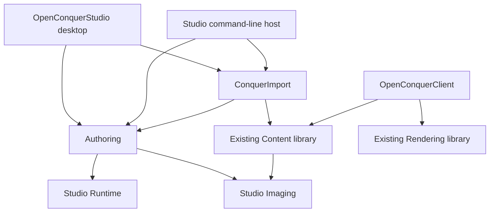

# Studio ownership

`OpenConquerStudio.slnx` builds the integrated Studio product in the same repository as its
first game. Sharing source ownership in one checkout avoids copied parsers, unpublished
package dependencies, and workstation-relative references to another repository. It remains
a dedicated solution; the game application and server are not Studio dependencies.

| Component | Responsibility |
| --- | --- |
| `OpenConquerStudio.Runtime` | Immutable validated pixels, image transforms, bounded `.octex` reader/writer. No GUI, import, game, or distribution dependency. |
| `OpenConquerStudio.Imaging` | One authoritative implementation of the existing TGA/DDS decoders and decoded-image type, shared with the first game. |
| `OpenConquerStudio.Authoring` | Stable project/asset identity, edit operations, source-file import, persistence, deterministic compilation, and content validation. |
| `OpenConquerStudio.ConquerImport` | Explicit adapter for supported existing client images, using their existing hash-checked loaders. |
| `OpenConquerStudio` | Desktop composition, dialogs, selection, property controls, operation lifecycle, and bitmap ownership. |
| `OpenConquerStudio.Tool` | Automation entry point for the same authoring operations and compiler. |

These are internal components of one product. There is no separate engine product, editor
framework, plugin framework, or speculative scene model. Texture assets have no outgoing
dependencies; a dependency graph and cycle checks become necessary with scene resources.

The authoring domain exposes immutable metadata and validates every changed document before
committing it to the session. `StudioProject` owns its lease and loaded pixels and is
single-owner, not thread-safe. Hosts serialize its operations. Selection and bitmap lifetime
belong to the desktop. A failed project open leaves the current project attached. Expected
operation failures reach the diagnostics panel; unexpected programming failures propagate.

## GUI and previews

Avalonia uses the same pinned version as the existing launcher. It provides desktop dialogs,
layout, splitters, accessibility properties, DPI-aware controls, and headless interaction
tests without introducing a custom GUI toolkit or another game engine. No docking dependency
is needed for three functional panels. Its MIT license supports commercial distribution;
the repository's existing dependency review remains applicable.

This slice previews individual images with Avalonia's bitmap control. The same
`TextureData.Transform` produces preview and compiled pixels. Preview conversion owns and
disposes its bitmap on the UI thread; importing and transforming run on a worker thread.

The existing OpenGL renderer owns an OpenGL 3.3 Core context and presents to framebuffer zero.
The existing platform host owns its window and context lifecycle. Neither contract is an
embedded editor viewport contract. A later shared-renderer integration must explicitly
support the editor's destination framebuffer, context/thread ownership, resize, context loss,
and disposal, with real rendering conformance. This slice does not fork shaders or introduce
a second scene renderer to bypass those requirements.

## Shared decoder extraction

The decoded-image type and TGA/DDS readers moved from Content into Imaging. Their namespace
is retained for source compatibility, and Content forwards the public `RgbaImage` type.
Its existing image loaders continue to call the same readers. Only reader visibility and
assembly ownership changed; the decode algorithms did not.

Content retains access to the image constructor for its existing generated artwork and BMP
adapter. Existing Content image tests also exercise the moved implementation. The complete
client solution is a compatibility gate for this extraction. No client gameplay, rendering,
networking, or server code is rewritten.

## Distribution direction

`content.json` and per-texture digests validate integrity, not publisher authenticity.
The existing launcher verifies signed release metadata using its pinned trust configuration;
the Product Tool constructs the client product and release packages. Those remain the release
boundary. Studio must eventually feed authored assets into that path rather than inventing
another signature format.

The current release contract identifies OpenConquer specifically. Multi-game product identity,
key management, platform builds, and publication need a reviewed extension of those contracts.
No signing API, private key, publishing button, or automatic runtime override is introduced here.
