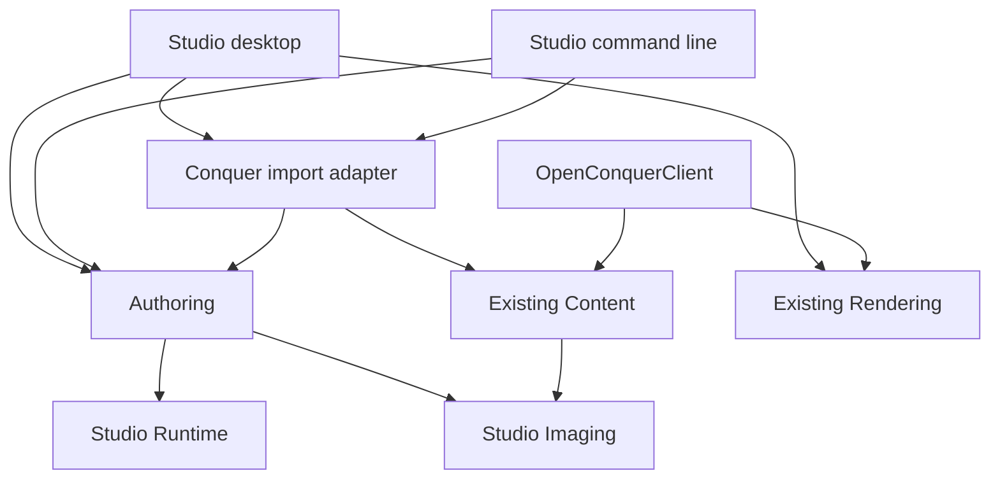

# Studio ownership

`OpenConquerStudio.slnx` builds one integrated product in the first game's repository.
Shared source ownership avoids copied parsers and unpublished cross-repository dependencies.
The client application and server are not Studio dependencies.

| Component | Owns |
| --- | --- |
| Runtime | Validated pixels, atlas regions, sprite clips and sampling, bounded resource codecs, complete build loading and graph validation. No editor/import/game dependencies. |
| Imaging | Authoritative existing TGA/DDS decoders and decoded-image type, shared with the client. |
| Authoring | Project identity, immutable edit transactions, history, typed dependencies, source import, revision storage, migration, deterministic compilation. |
| ConquerImport | Supported client-artwork catalog through existing hash-checked loaders. |
| Desktop | Project orchestration, dialogs, selection, inspectors, playback controls, bitmap and GPU-host lifecycle. |
| Tool | Command-line access to authoring and compilation. |
| RenderCheck | Platform validation executable using generated assets, compiled runtime loading, and actual embedded framebuffer readback. |

These are internal components. No independent engine framework, plugin system, or speculative
scene hierarchy is introduced. Runtime owns compiled format decoding; the compiler validates
its output through that same runtime loader. Runtime's internal bounded filesystem/JSON
utilities are shared with Authoring through explicit assembly access.

## Editing and dependencies

A session owns its exclusive project lease and immutable pixel data. Hosts serialize operations;
`StudioProject` is single-owner and is not thread-safe. Every edit validates the complete proposed
document before replacing the current snapshot. Failed edits do not enter history.

Textures have no dependencies. An atlas references one texture; frames reference an atlas and
one of its stable sprite IDs. This typed ordering makes cycles unrepresentable in this schema.
Delete impact includes transitive dependents. Removing referenced sprites or resizing a texture
beyond atlas bounds fails before mutation. Future resource kinds must extend graph validation,
including cycle detection when their reference rules permit cycles.

Undo/redo retains at most 50 transactions and 128 MiB of unique pixel payloads across history
and the active snapshot. Metadata is bounded per project. Editing after undo drops redo history.
Saved-state feedback follows the saved snapshot; returning to that snapshot clears modified state.
History is session-local, not a persisted recovery log.

Each resource saves as an immutable, digest-addressed JSON revision under its stable asset GUID.
Pixels are immutable blobs. The root index commits all revisions with one atomic replacement.
This avoids a multi-file overwrite journal. Failed writes can leave unreferenced revisions;
opening follows only the last committed index. Schema 1 migration creates an explicit independent
copy and preserves project/resource IDs. No source project is upgraded in place.

## Desktop and GPU ownership

Avalonia uses the launcher's pinned version. Built-in controls provide desktop dialogs,
layout, splitters, accessibility, high-DPI support, and headless interaction testing. No docking
library or second graphics engine is needed for this slice.

`AtlasEditor` edits rectangles and pixel pivots. `AnimationEditor` edits stable frame references,
order, duration, timebase, and repeat mode. `AnimationTransport` samples elapsed time through
Runtime; frame timing does not depend on render frequency. `AssetPreview` owns source-pixel
inspection and the engine viewport. Large import/transform/save/build work runs off the UI thread.

`StudioViewport` uses `OpenGlControlBase` and the existing `OpenGLGraphicsDevice`/`OpenGLRenderer`.
The renderer now accepts a caller-owned presentation framebuffer. Its existing no-argument
`EndFrame()` retains framebuffer-zero behavior for the client. Nonzero destinations are checked
for completeness and single sampling on every presentation; Avalonia can replace attachments.

Desktop OpenGL profiles are selected explicitly: WGL on Windows, GLX on Linux, and OpenGL on
macOS. Other compositor backends cannot be assumed to provide the required context sharing.
Source-pixel inspection remains available when a compatible GPU context cannot be created;
the viewport reports that failure instead of claiming a software image is engine rendering.

Only init/render/deinit callbacks issue GL calls. CPU frame snapshots survive context loss;
GPU names are discarded without issuing deletion calls on a lost context. Detachment releases
textures, renderer, and device while the context is current. Textures upload lazily once per
selected preview snapshot, not every animation tick. Resize and display scaling affect the
host framebuffer; the editor's 512 × 512 logical preview uses the shared presentation rules.

RenderCheck validates generated compiled assets through real framebuffer readback. Headless
control tests cover authoring interactions and source pixels; they do not prove GPU output.
Native dialogs, accessibility, display scaling, and driver-specific behavior require platform
manual validation. Automated GPU coverage is listed separately in the validation record.

## Compatibility and release boundaries

Shared image algorithms remain unchanged. Their original namespace and `RgbaImage` type
forwarder preserve client compatibility. The shared renderer extension requires the complete
client regression suite in addition to Studio checks. Client gameplay, networking, world
ordering, and server contracts are outside this change.

Integrity hashes do not establish publisher authenticity. Existing launcher trust, signed release
metadata, and Product Tool packaging remain the release path. Client resource bindings,
multi-game release identity, protected signing, publication, maps, and characters need later
coordinated slices. Imported image associations do not automatically replace client resources.
